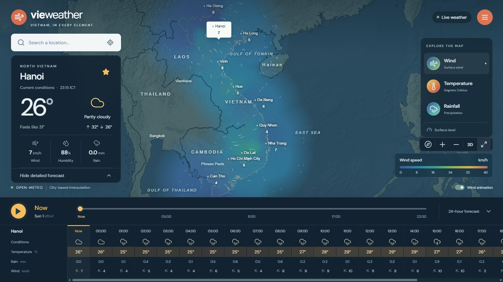

# VieWeather

A map-first Vietnam weather app with a full-screen interactive map, animated wind, and an Apache Spark Structured Streaming data pipeline. All documentation and UI text are in English.



## Run locally

Requires Node.js 22+ and Python 3.11+. From this directory:

```powershell
python -m venv .venv
.\.venv\Scripts\python -m pip install -r requirements.txt
npm ci
npm run build
.\.venv\Scripts\python -m uvicorn backend.main:app --host 127.0.0.1 --port 8010
```

Open **http://127.0.0.1:8010**. API documentation is at **http://127.0.0.1:8010/docs**.

Windows shortcut: run `./scripts/start.ps1` (or `./scripts/start.ps1 -Mode demo`). This sets up missing dependencies, builds, and starts the app in the current terminal.

On macOS/Linux, use `.venv/bin/python` in place of `.\.venv\Scripts\python`.

For frontend development, run `npm run dev` in another terminal. Vite serves port 5173 and proxies API requests to port 8010. `npm run api` uses the `python` on your PATH; activate the virtual environment first. The production API serves the built frontend, so rebuild after frontend edits. `npm run preview` is only a static preview; use the API server for the complete app.

### Predictable offline demonstration

```powershell
$env:WEATHER_MODE = "demo"
.\.venv\Scripts\python -m uvicorn backend.main:app --host 127.0.0.1 --port 8010
```

Demo mode emits synthetic observations every 10 seconds. Live mode polls Open-Meteo every 10 minutes and stores unique provider observations. On first start, explicitly labeled sample data appears until the first successful provider response. Cached data is retained if the provider fails; cached forecasts older than 30 minutes are labeled stale. Demo data is never relabeled as live.

## Run the complete Spark stack

Requires Docker Desktop with Linux containers and approximately 4 GB available memory:

```powershell
docker compose --profile streaming up --build
```

App: **http://127.0.0.1:8010** · Spark UI: **http://127.0.0.1:4040**

For a continuously moving class demonstration, copy `.env.example` to `.env`, set `WEATHER_MODE=demo`, and run the command above. `.env` is read by Docker Compose; for local Python, set shell environment variables instead. Stop services with `docker compose --profile streaming down`. Data survives in `data/`.

Spark can also run directly on Linux/WSL with Python 3.11, Java 17, and `pyspark==3.5.3`:

```bash
export JAVA_HOME=/path/to/java17
export PYSPARK_PYTHON=/path/to/python3.11
export DATA_DIR=/absolute/path/to/VieWeather/data
spark-submit --master 'local[2]' --driver-memory 2g pipeline/stream.py
```

The app and Spark must use the same data directory. `local[2]` is a reproducible single-machine teaching configuration, not a distributed cluster deployment. Spark's processing code can run on a cluster when shared storage, checkpoints, and the serving sink are adapted to that environment.

## What works

**Weather**
- Live current weather for 27 cities across North, Central, Highlands, and South Vietnam.
- Seven-day forecasts with sunrise/sunset, peak wind and daily rainfall totals.
- Animated 24-hour SVG chart for temperature, rainfall or wind, scrubable by drag or keyboard.
- Sunrise/sunset daylight arc, moon phase with a true terminator, and a full air-quality panel
  (US EPA AQI with PM2.5 / PM10 / O₃ / NO₂ / SO₂ / CO breakdown).
- Condition-based weather alerts (heavy rain, high wind, low visibility, heat, poor air) derived
  from the live observations, shown in a dismissible alert stack.
- Detail grid: pressure, visibility, dew point, UV index, wind gust, cloud cover.

**Map**
- MapLibre WebGL map with three animated basemap modes — **Dark**, **Satellite** (Esri World
  Imagery) and **Terrain** (Esri relief + Terrarium hillshade) — cross-faded, never snapped.
- **3D mode**: real terrain relief at 1.6× exaggeration plus tapered, data-driven weather columns
  rising from every city, coloured and sized by the selected layer and forecast hour.
- Smooth temperature, rainfall and wind fields interpolate the 27 monitored cities and fade outside
  coverage. These are illustrative city-based fields, not a global weather model.
- Animated wind streamlines that follow observed direction; forecast playback morphs them over time.

**Interaction and motion**
- Every click ripples and presses; panel entrances reveal and stagger into view; numeric values
  count up smoothly; forecast playback and city changes animate the map camera.
- A full-screen ambient weather canvas reacts to the focused city — rain, drizzle, snow, fog,
  drifting cloud, sun shafts, night stars, and thunderstorms with branching lightning.
- ⌘K / Ctrl+K command palette with fuzzy, accent-insensitive city search.
- City search, regional filters, nearest monitored city via browser geolocation, persistent
  favourites, and Celsius/Fahrenheit, all stored locally.
- Respects `prefers-reduced-motion` throughout: the ambient layer becomes a static gradient, all
  transitions snap, and no ripple or press animation fires.

**Data platform**
- Server-sent update notifications, SQLite history, CSV export, regional analytics, stream monitoring.
- Air quality, sun/moon and ranked city-search API endpoints (`/api/air-quality/{id}`,
  `/api/cities/search`, `/api/alerts`).
- Spark schema validation, quarantine, bounded duplicate removal, event-time windows, persistent checkpoints, Parquet storage, and API-visible output.
- Synthetic load generation, a batch SQL analysis example, English specification, and course experiment guide.


## Map detail and data provenance

The basemap is **OpenFreeMap / OpenMapTiles vector** (`tiles.openfreemap.org`), so zooming in reveals
real Vietnamese geography rather than a static picture: `name:vi` place labels by class (country,
province, city, town, village, OSM suburb), administrative boundaries at `admin_level` 2 / 4 / 6,
the road network, rivers, and building footprints. `maxZoom` is 15.

**Temperature is printed beside every place name.** A 5,187-entry Vietnam gazetteer
(`backend/places.json`, generated by `scripts/build_places.py` from the GeoNames dump) supplies
7 major cities, 46 province capitals, 634 district towns and 4,500 commune/ward seats. Label density
is gated by `rank` and zoom so the map fills in progressively instead of cluttering: rank 1 from
zoom 3.4, rank 2 from 4.2, rank 3 from 7, rank 4 from 9.5. MapLibre handles collisions.

### Which forecast you are reading

Weather comes from **Open-Meteo**, which serves several numbered models. The app defaults to
**ECMWF IFS 0.25°** because that is the model Windy reads, so the numbers agree. You can switch
models in the menu (ECMWF / Blend / ICON / GFS) — the active model is shown in the map source strip
and carried on every payload, so a number is always traceable.

Measured, Ha Noi, 2026-11-09 18:00Z, same instant:

| model | temperature | humidity |
|---|---|---|
| best_match (Blend) — the old default | 17.3 °C | 54 % |
| **ecmwf_ifs025 — now the default** | **16.1 °C** | **74 %** |
| icon_seamless | 16.7 °C | 85 % |

That humidity gap is why the app previously looked different from Windy on the same city at the same
minute. It is not a bug in the data — different models genuinely disagree, and ECMWF is the one to
compare against Windy.

### The dense field

`GET /api/field` samples a **20 × 17 grid (340 points)** straight from the provider across
lon 102.0–109.8 / lat 8.6–23.4, about 0.4° spacing. This replaces the old 25-city inverse-distance
blur, so contours follow the terrain — cool highlands, warm basins, the rain shadow behind the
Truong Son. Points are row-major with row 0 at the south edge.

Provenance is reported honestly and never dressed up: `source` is `live` (provider grid at full
resolution), `cache` (real data older than the TTL), `coarse` (reduced 10 × 9 grid after a provider
error), or `synthetic` (nothing real available). A synthesized grid is never drawn as weather — the
client falls back to a field built from the real cached city observations instead. The last good grid
is persisted to `data/field-<model>.json` so a restart keeps serving real data.

### Provider quota

Open-Meteo's free tier meters **600 units/minute, 5,000/hour and a daily cap**, at roughly one unit
per requested coordinate. `backend/budget.py` reserves units against both short windows before every
call, so the 340-point grid refresh and the 25-city poll can never collide. If the daily cap is ever
exhausted, the app keeps serving the last real reading and labels itself **Cached weather** rather
than inventing values — the quota resets on the provider's schedule.

## Big-data experiments

Start Spark, then generate a synthetic stream:

```powershell
python scripts/generate_load.py --events 100000 --batch-size 5000 --interval 0.2
```

All generated records use `source=load-test` and never replace actual forecasts. Default rates: 5% duplicate rows, 1% invalid new events, and 2% late new events. Late events are 45 minutes behind arrival. A late event in the first batch can still be accepted before the watermark advances: inspect Spark metrics rather than assuming every late event is dropped.

The **Menu → Data pipeline** workspace displays a driver heartbeat and actual latest-trigger metrics, including input rows, processing rate, and state memory. `scripts/lake_report.py`, run with `spark-submit` and the same `DATA_DIR`, reports source-separated lake counts and storage bytes. A 100,000-row workload and checkpoint-recovery test have been run; their measured results are in `docs/VERIFICATION.md`.

To run batch analysis while the streaming container is active:

```powershell
docker compose exec spark /opt/spark/bin/spark-submit --master "local[2]" /opt/vieweather/batch_analysis.py
```

Read [the course guide](docs/COURSE_GUIDE.md) for volume/velocity experiments, metrics, correctness checks, and a presentation outline. Read [the English specification](docs/SPECIFICATION.md) for scope, architecture, data contracts, and acceptance criteria.

## Verification

```powershell
python -m pytest tests -q
npm run build
npm audit
```

The optional Spark integration smoke test requires the same Java 17 / PySpark 3.5.3 environment:

```bash
python scripts/spark_smoke.py
```

See [verification results](docs/VERIFICATION.md) for the checks performed during implementation.

## Project layout

```text
src/                    React/TypeScript interface and weather map
public/asia.geojson      Simplified Natural Earth country geometry
backend/                FastAPI, provider adapter, event log, serving database
pipeline/stream.py      Three Spark Structured Streaming queries
pipeline/batch_analysis.py  Batch SQL example
scripts/generate_load.py    Reproducible synthetic workload generator
scripts/spark_smoke.py      Real Spark streaming integration test
tests/                  API, persistence, and adapter tests
docs/                   Specification, course guide, verification
compose.yaml            App and optional Spark service
data/                   Generated SQLite, events, Parquet, checkpoints (ignored)
```

## Data and operational limits

Open-Meteo supplies model-derived weather, not a nationwide sensor network or official alerts. Free API use is subject to its [terms](https://open-meteo.com/en/terms) and [CC BY 4.0 attribution](https://open-meteo.com/en/licence). Natural Earth data is [public domain](https://www.naturalearthdata.com/about/terms-of-use/); geometry is simplified and is not authoritative for boundaries. Terrain context uses the [Esri World Physical Map](https://server.arcgisonline.com/ArcGIS/rest/services/World_Physical_Map/MapServer). Fonts use Google Fonts with local system fallbacks.

The app is bound to localhost by default and has no accounts or authentication. SQLite serves the course demo; Spark data lives separately in the lake. CSV export is capped at the latest 100,000 API-ingested observations. Load-test events appear in Spark, not the API's SQLite observation counts. Incoming files and lake outputs accumulate; use a fresh `DATA_DIR` for isolated experiments and plan retention before long-running use. Never remove checkpoints from an active stream. Gold is a bounded snapshot of the latest changed windows, while silver contains all window updates; use the newest batch per window when querying silver.