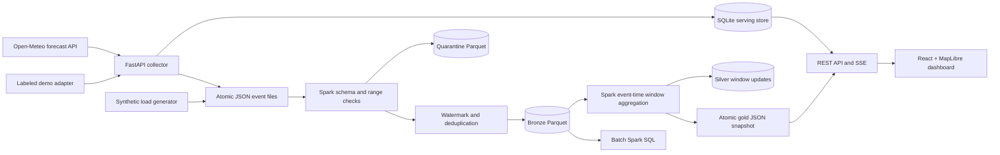

# VieWeather — English project specification

## 1. Purpose and scope

Build an operational weather application focused on Vietnam that demonstrates both useful visual analysis and the core ideas of big-data processing. A user can explore current and forecast weather geographically, while a student can inspect ingestion, stateful stream processing, storage, data quality, recovery, and batch analytics.

The monitored locations are 25 selected Vietnamese cities, not every administrative unit. Region labels are analytical groupings, not official administrative boundaries. The 3D map contains geographic polygons, optional elevation, and data-driven weather columns. It is not a weather simulation, radar product, or volumetric cloud model.

## 2. Architecture



Three concurrent Spark queries separate validation/deduplication, invalid-record storage, and aggregation. This avoids unsupported chains of stateful operations in update mode. A file stream is an actual Structured Streaming source; Kafka is not required by the selected course constraint. For a Kafka extension, preserve the event schema and replace the raw source with Kafka `value` JSON parsing plus a dead-letter topic.

## 3. Functional requirements

| ID | Requirement | Delivered behavior |
| --- | --- | --- |
| W1 | Vietnam coverage | 27 configured locations with four region filters |
| W2 | Current conditions | Temperature, feels-like, humidity, wind, pressure, cloud cover |
| W3 | Forecasts | 24-hour chart, map playback, seven daily forecasts |
| M1 | Interactive 3D map | Pan, rotate, zoom, tilt, reset, city selection |
| M2 | Weather layers | Temperature, precipitation, wind columns; changing time updates values |
| M3 | Terrain | Toggle remote Terrarium elevation with 1.6× exaggeration |
| M4 | Basemaps | Dark / Satellite (Esri World Imagery) / Terrain (Esri relief + DEM hillshade), cross-faded |
| M5 | 3D weather columns | Tapered extruded columns per city, coloured and sized by active layer and hour |
| M6 | Ambient weather | Full-screen canvas: rain, drizzle, snow, fog, cloud, sun shafts, stars, thunder |
| U3 | Motion | Click ripples, staggered reveals, count-up numbers, animated camera; reduced-motion aware |
| U4 | Command palette | Ctrl/⌘K fuzzy city search with keyboard navigation |
| D3 | Atmosphere | Sun arc, moon phase, air quality (US EPA AQI) and derived weather alerts |
| U1 | Location discovery | Search, region filter, nearest monitored city |
| U2 | Preferences | Favorites and temperature unit saved in local storage |
| D1 | Source honesty | Per-city source, observation/fetch times, stale indicator, demo banner |
| D2 | API data | History query, CSV export, SSE updates, OpenAPI docs |
| B1 | Stream ingestion | Atomically published replayable JSON batches |
| B2 | Quality | Typed schema, null/range validation, quarantine |
| B3 | Stateful processing | 20-minute watermark and event-ID deduplication |
| B4 | Window analytics | 10-minute windows sliding every 5 minutes, grouped by city/region/source |
| B5 | Storage/recovery | Parquet partitions and persistent query checkpoints |
| B6 | Evaluation | Load generator, Spark UI, smoke tests, batch SQL |

## 4. Event contract

UTF-8 newline-delimited JSON. Producers write `.tmp` then rename to `.json` in the same directory. Spark reads only `*.json`.

```json
{
  "event_id": "64-character lowercase SHA-256 digest",
  "city_id": "hanoi",
  "region": "North",
  "event_time": "2026-11-01T12:00:00Z",
  "ingested_at": "2026-11-01T12:01:00Z",
  "source": "open-meteo",
  "temperature": 27.2,
  "humidity": 82.0,
  "wind": 9.1,
  "precipitation": 0.0
}
```

`temperature`: °C, range −30..60. `humidity`: %, range 0..100. `wind`: km/h, range 0..400. `precipitation`: mm, range 0..1000. Sources are `open-meteo`, `demo`, and `load-test`. Event and ingestion timestamps must parse; event time must not be more than one hour in the future. Provider event IDs hash `(city, observation timestamp, source)`, so repeated polls of one observation are deduplicated. This intentionally keeps the first version of a provider observation rather than treating provider revisions as independent measurements.

All stored timestamps are UTC. Browser displays use Asia/Ho_Chi_Minh (UTC+7). Daily forecasts use Vietnam local dates. Sources remain distinct in every aggregate to prevent synthetic data contaminating real-weather statistics.

## 5. Stream semantics

- **Bronze:** valid, deduplicated events, partitioned by `event_date` and `source`.
- **Quarantine:** invalid records, including corrupt JSON when Spark can retain it, with rejection time.
- **Silver:** changed window rows written to a deterministic `batch-N` folder. Retries overwrite that batch; downstream queries must resolve updates by window keys and largest batch ID.
- **Gold:** latest nonempty batch, up to 500 changed windows, sorted by newest window. This is a recent-update view, not a materialized table of every window.
- **Watermark:** maximum observed event time minus 20 minutes. Old events may be dropped once the watermark advances. Watermarks are event-time based and do not advance during a completely idle source.
- **Duplicates:** `dropDuplicatesWithinWatermark(event_id)` bounds state. It is not permanent global deduplication. Persisted checkpoints are required for recovery; resetting them changes replay semantics.
- **Guarantees:** file-source offsets/checkpoints plus Spark's Parquet sink log support restart-safe processing for bronze. Silver uses replaceable batch directories; gold uses atomic same-directory replacement. There is no claim of end-to-end global exactly-once delivery across unrelated systems or deleted checkpoints.
- **Precipitation:** windows report the maximum sample, not a sum: repeated provider interval estimates should not be added as independent rainfall totals.

## 6. API

| Method and path | Purpose |
| --- | --- |
| GET `/api/health` | Process health, mode, provider error, last poll |
| GET `/api/weather` | Cached current/forecast data for all cities |
| GET `/api/history/{city_id}?hours=24&source=open-meteo` | 1–168-hour history, at most 10,000 rows |
| GET `/api/analytics` | SQLite ingestion counts, recent data, regional statistics, Spark output |
| GET `/api/events` | SSE invalidation event and heartbeat every five seconds |
| GET `/api/export` | Latest 100,000 API observations as CSV |
| GET `/docs` | Interactive API documentation |

The UI's Refresh button reloads the API cache; it does not bypass the provider polling interval. SSE notifies clients when collection updates the cache. Client polling every minute provides additional resilience.

## 7. Nonfunctional requirements

Use a reproducible lockfile, typed frontend compilation, API contract tests, clear failure states, responsive layouts, keyboard-accessible controls, and external-data attribution. Avoid exposed secrets and mandatory paid map keys. Keep map geometry available locally. Detect stale weather and distinguish unavailable Spark output from actual processing.

SQLite, local files, one collector, and Spark `local[2]` are course-scale deployment choices. Production evolution requires authentication, provider licensing/capacity review, durable shared/object storage, a scalable serving database, retention/compaction, alerts, metrics, and deployment hardening. These are extensions, not hidden claims about this version.

## 8. Acceptance checks

1. Build frontend and start API; obtain all 25 live or explicitly labeled demo forecasts.
2. Select Hanoi and Da Nang from map/list; verify weather details change.
3. Switch metric, unit, 2D/3D, and timeline; verify map values respond.
4. Search/filter, save a city, reload, and verify saved preferences persist.
5. Start Spark, publish observations, verify bronze, gold, and UI analytics.
6. Supply duplicates/invalid records; verify deduplication and quarantine.
7. Restart from checkpoints; confirm already committed input is not replayed as new bronze output.
8. Run load experiments, record measured throughput/state/latency, and explain scaling limits.